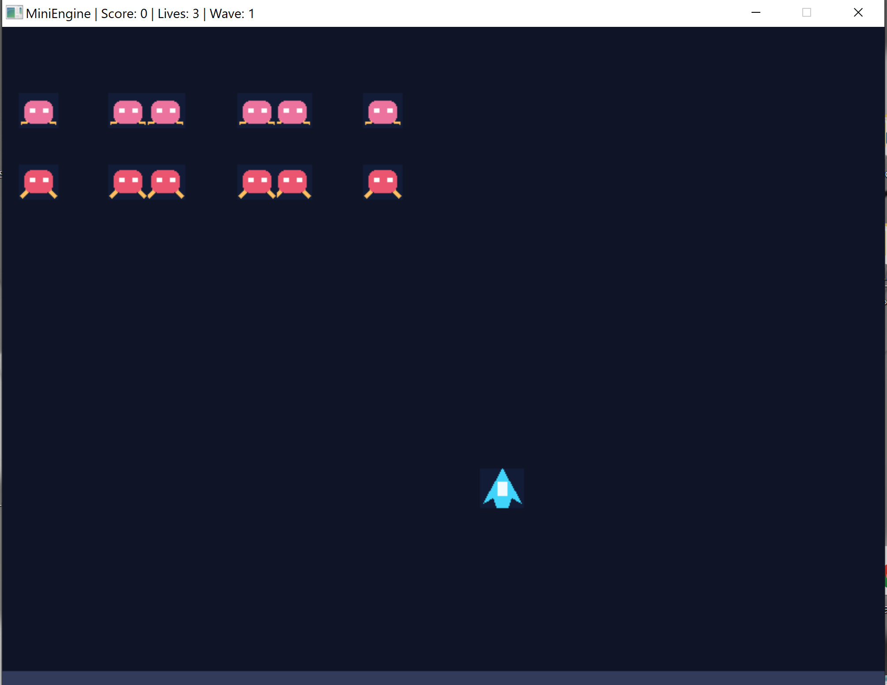

# MiniEngine — 2D Space Shooter

A small 2D arcade space shooter developed with **C++17 and SDL2**, featuring a modular object-oriented architecture.

## Features

- Player movement using keyboard controls
- Enemy spawning and sprite-sheet animations
- Player shooting mechanics
- AABB collision detection
- Score and lives tracking
- Wave-based gameplay
- Win and game-over states
- Game restart functionality
- Delta-time-based movement
- Texture caching and resource management

## Controls

| Key | Action |
|---|---|
| Arrow Keys | Move the player |
| Space | Shoot |
| R | Restart the game |
| Esc | Quit |

## Screenshot



## Technologies

- C++17
- SDL2
- CMake
- MinGW-w64 / MSYS2
- Git and GitHub

## Project Architecture

- **Engine:** Initializes SDL2, manages the game loop, events, game states, and rendering.
- **GameObject:** Abstract base class for game entities.
- **Player:** Handles player movement and rendering.
- **Enemy:** Handles enemy movement, animation, and rendering.
- **TextureManager:** Loads, caches, and releases textures.
- **Collision:** Provides AABB collision detection.

## Build Instructions (Windows / MSYS2 UCRT64)

Requirements: CMake, MinGW-w64 C++ compiler, and SDL2 development libraries.

```powershell
cmake -S . -B build -G "MinGW Makefiles"
cmake --build build
.\build\MiniEngine.exe
```

Make sure the MSYS2 UCRT64 toolchain and SDL2 libraries are installed and available to CMake.

## Known Limitations

- Designed as a small educational game, not a general-purpose engine.
- Uses simple BMP graphics and basic collision detection.
- No audio system or advanced physics.

## Project Status

Playable educational project. Core gameplay features have been tested on Windows.

## What I Learned

This project helped me practice object-oriented programming, smart pointers, resource ownership, SDL2 rendering, delta-time movement, collision detection, debugging, and organizing a C++ project with CMake.

## Gameplay Screenshot


